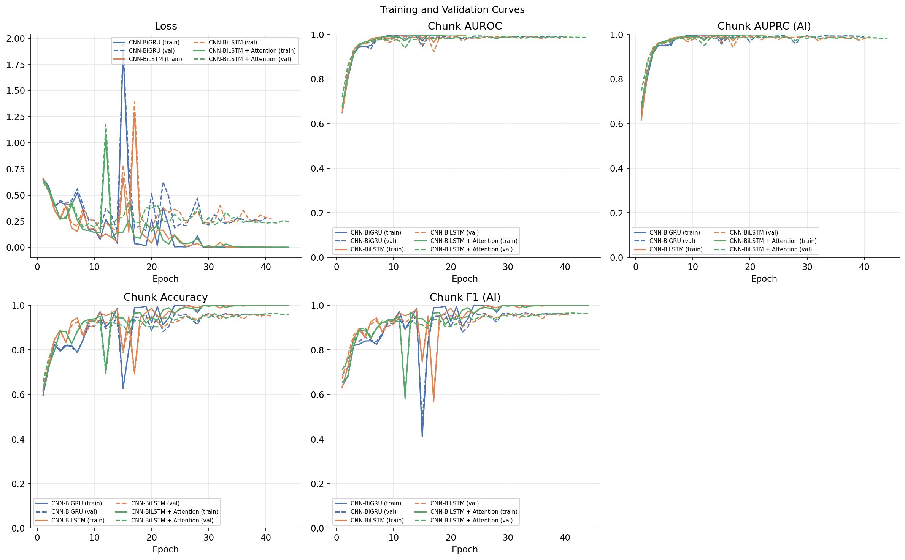
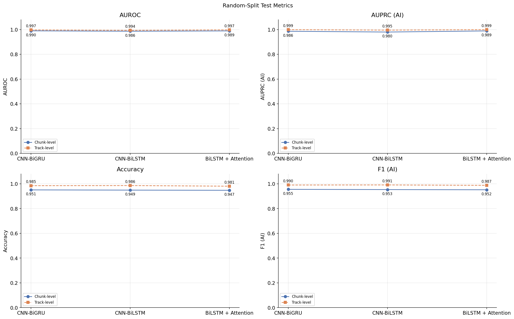

# AI Music Detection: CNN-BiGRU, CNN-BiLSTM, and Temporal Attention

This project studies binary classification of **AI-generated music** and **non-AI-generated music** from audio. It builds on the existing AI Music Detection repository and its spectrogram, data, and training workflow, then adds a controlled comparison of three temporal architectures.

The comparison is designed to isolate the temporal model: the CNN feature extractor, segmented log-mel input, classifier head, dataset, data splits, training configuration, checkpoint rule, and evaluation protocol are shared.

## Project contributions and attribution

This repository is based on [Nikoloz Darsalia's AI Music Detection project](https://github.com/NikolozDarsalia/AI_Music_Detection). Its original MIT license and attribution are preserved in [LICENSE](LICENSE).

The inherited project provides the data collection and EDA notebooks, MERT hard-negative mining, chunk and spectrogram preprocessing, train/validation/test splitting, training and evaluation utilities, and the original CNN-BiGRU baseline. My contributions for this comparison are:

- A CNN-BiLSTM that replaces only the two-layer bidirectional GRU with a two-layer bidirectional LSTM.
- A CNN-BiLSTM with learned temporal attention over the BiLSTM output sequence.
- A shared model selector and a notebook experiment that records parameter counts, training time, inference throughput, and chunk- and track-level metrics.

The original CNN-BiGRU architecture is retained. The comparison names it **CNN-BiGRU** to make its bidirectional recurrent layer explicit.

## Models

All models accept segmented log-mel spectrograms shaped `(batch, segments, 1, mel_bins, segment_frames)` and return two logits for human and AI classes. The CNN produces a feature vector for each segment. The bidirectional recurrent layer produces a sequence shaped `(batch, time, 2 × hidden_size)`.

| Model | Temporal layer | Temporal pooling | Status |
| --- | --- | --- | --- |
| CNN-BiGRU | Two-layer bidirectional GRU | Mean over time | Inherited baseline |
| CNN-BiLSTM | Two-layer bidirectional LSTM | Mean over time | Added comparison model |
| CNN-BiLSTM + Temporal Attention | Same two-layer bidirectional LSTM | Learned attention-weighted sum | Added comparison model |

For the attention model, a learned linear projection assigns one score to each BiLSTM output. Softmax across time converts the scores into weights that sum to one. The weighted sum of the sequence has shape `(batch, 2 × hidden_size)` and is passed through the same classification head used by the other models.

Model definitions and the `cnn_bigru`, `cnn_bilstm`, and `cnn_bilstm_attention` selector are in [`src/models.py`](src/models.py). The legacy selector `cnn_gru` remains available as an alias for existing notebooks and workflows.

## Data and preprocessing

The existing project workflow uses FMA as the non-AI source and Udio and Suno as AI sources. Data collection and metadata preparation are covered by `01_Data_Collection.ipynb` and `02_EDA.ipynb`. The notebooks and source code use:

- 10-second audio chunks at 22,050 Hz, with RMS normalization.
- 128-bin log-mel spectrograms, 2,048-point FFT, 512-sample hop, and an 8,000 Hz upper frequency.
- Global spectrogram standardization using statistics computed from training chunks only.
- Ten sequential segments per chunk, each represented by 43 spectrogram frames; the unused remainder is cropped according to the existing dataset logic.
- Optional SpecAugment on training data only.

Track-level splitting prevents the same track from appearing in multiple splits. The default random split uses 70% train, 15% validation, and 15% test with seed 42. The existing cross-source split options are also available. For a fair architecture comparison, select one prepared manifest and keep it fixed for all three models.

The original workflow also supports MERT-based hard-negative mining. The model comparison cells use the same `manifest_mined` and the same sequence dataloaders for all architectures. To compare another sampling strategy, build a different manifest once and use it consistently across the three runs.

## Training and evaluation

The comparison uses the existing training loop and the same configuration for each model:

| Setting | Value |
| --- | ---: |
| Optimizer | AdamW |
| Loss | Cross-entropy |
| Learning rate | 0.0001 |
| Weight decay | 0.0001 |
| Batch size | 64 |
| Maximum epochs | 50 |
| Warmup | 3 epochs |
| Plateau scheduler | Validation loss, patience 8, factor 0.5, minimum LR 0.000001 |
| Early stopping | 15 epochs without checkpoint-metric improvement |
| Checkpoint selection | Best validation AUROC |
| Augmentation | SpecAugment, frequency mask 15, time mask 30, two masks each |
| Random seed | 42, reset before each model run |

The test set is used only after the best checkpoint has been selected using validation AUROC. The comparison reports test metrics at the fixed threshold 0.5; it does not tune a threshold on test data. If threshold tuning is desired for a separate analysis, select the threshold from validation predictions and apply that fixed threshold to test predictions.

Evaluation includes chunk-level and track-level AUROC, AUPRC, accuracy, and F1. Track predictions use the existing mean aggregation of chunk probabilities. The comparison also records trainable parameter count, elapsed training time, and inference throughput after one unmeasured warmup batch. Inference throughput includes DataLoader iteration time and is intended as a practical end-to-end measure on the selected device.

## Setup

Python 3.13 or newer is specified in `pyproject.toml`. Install dependencies with `uv`:

```bash
uv sync
```

The existing data collection notebook downloads data from Hugging Face and may require a Hugging Face read token. Follow its setup instructions and keep tokens outside version control. Do not commit audio datasets, credentials, generated spectrograms, or model checkpoints.

## Run the comparison

1. Run `01_Data_Collection.ipynb`, then `02_EDA.ipynb` to prepare audio and metadata.
2. In `03_Models_Experimentations.ipynb`, generate or load the splits and spectrogram manifests using the existing workflow.
3. Select a single strategy in `ACTIVE_STRATEGY`. Prepare the MERT-mined manifest if using the current comparison cells.
4. Use the comparison-only CPU runner. It prepares or reuses the selected split, chunks, spectrograms, and MERT-mined index, validates the data and sampler sequence, then trains only the three temporal models.

```bash
.venv/bin/python src/run_comparison.py --strategy random --prepare-only
.venv/bin/python src/run_comparison.py --strategy random
```

The first command stops after data preparation and checks; the second runs all three models sequentially on CPU. The runner uses the original 50-epoch training configuration and validation-AUROC checkpoint selection. It refuses to replace existing experiment outputs unless `--overwrite` is passed.

For each model, best and last checkpoints are saved under `checkpoints/<model>/<strategy>/`, histories and predictions under `logs/<model>/<strategy>/`, and evaluation summaries under `results/<model>/<strategy>/`. The combined comparison is written to `results/architecture_comparison/<strategy>.csv`.

## Experimental results

The following results are from the completed CPU comparison using the random track split, seed 42, a shared MERT-mined training subset, and the same training configuration for all models. The test set contained 8,870 chunks from 982 tracks. Checkpoints were selected by validation AUROC; the test threshold remained at the default 0.5 and was not tuned on test data. Training stopped through the existing early-stopping rule.

| Model | Parameters | Epochs (best) | Training time | Inference (chunks/s) | Chunk AUROC / AUPRC (AI) / accuracy / F1 (AI) | Track AUROC / AUPRC (AI) / accuracy / F1 (AI) |
| --- | ---: | ---: | ---: | ---: | --- | --- |
| CNN-BiGRU | 903,266 | 40 (25) | 141.90 min | 143.70 | 0.9896 / 0.9862 / 0.9507 / 0.9552 | 0.9967 / 0.9991 / 0.9847 / 0.9901 |
| CNN-BiLSTM | 1,166,434 | 41 (26) | 146.28 min | 143.45 | 0.9864 / 0.9798 / 0.9489 / 0.9533 | 0.9935 / 0.9953 / 0.9857 / 0.9908 |
| CNN-BiLSTM + Temporal Attention | 1,166,691 | 44 (29) | 158.68 min | 140.46 | 0.9890 / 0.9890 / 0.9475 / 0.9516 | 0.9971 / 0.9992 / 0.9807 / 0.9874 |

These are measured outcomes from this run, not estimates. Full precision metrics, histories, test predictions, and checkpoints are saved in the per-model output directories; `results/architecture_comparison/random.csv` contains the consolidated comparison. The original notebook contains earlier results from its existing workflow; those are historical results and are not part of this controlled three-model run.

### Comparison figures

The history plots show chunk-level metrics over training and validation epochs. Solid lines indicate training and dashed lines indicate validation. The test figure compares chunk-level and track-level results. Plot colors, line widths, grids, font sizes, and figure proportions follow the original notebook's muted palette and comparison-curve conventions.





### Interpretation and limits

On this random split, CNN-BiGRU had the highest chunk accuracy (0.9507) and AI F1 (0.9552). CNN-BiLSTM + Temporal Attention had the highest chunk AI AUPRC (0.9890), track AUROC (0.9971), and track AI AUPRC (0.9992). CNN-BiLSTM had the highest track accuracy (0.9857) and track AI F1 (0.9908). No model led on every measure. The attention model added only 257 trainable parameters over the CNN-BiLSTM, but its recorded CPU run time was longer in this experiment.

These results describe one random track split of this dataset. The split includes tracks from the same source families across training, validation, and test; it is not a held-out-source or held-out-generator evaluation. The figures and scores therefore do not establish performance on unseen music generators, future releases, or other datasets. No multi-seed averages or statistical significance tests were run. The results table and conclusions should be read as a comparison on this split only.

The detailed training histories, prediction files, and model checkpoints are experiment artifacts and are not included in the publication set. The consolidated comparison CSV and figures are included for reproducibility and inspection.
